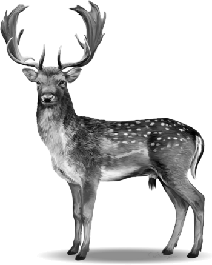
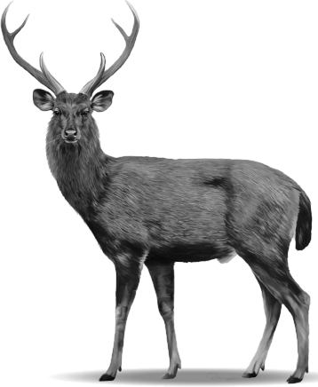

# Australia-scale biomass of main feral deer and relevant macropod species

Dama dama</em>)" width="130" style="margin-top: 20px">

Calculate and compare total biomasses of main feral deer and macropod species in Australia. Comparison includes commercially surveyed large macropods and additional species with <a href="https://ala.org.au">Atlas of Living Australia</a> records in the <a href="https://www.agriculture.gov.au/abares">Australian Bureau of Agricultural and Resource Economics and Sciences</a> (ABARES) 2026 <a href="https://www.agriculture.gov.au/abares/research-topics/invasive-species/feral-deer">deer-occurrence grid</a>.

 
Prof <a href="https://globalecologyflinders.com/people/#DIRECTOR">Corey J. A. Bradshaw</a>  
<a href="http://globalecologyflinders.com" target="_blank">Global Ecology</a> | <em><a href="https://globalecologyflinders.com/partuyarta-ngadluku-wardli-kuu/" target="_blank">Partuyarta Ngadluku Wardli Kuu</a></em>, <a href="http://flinders.edu.au" target="_blank">Flinders University</a>, Adelaide, Australia  
April 2026  
<a href=mailto:corey.bradshaw@flinders.edu.au>e-mail</a>  
 

## Species compared
### deer

- <a href="https://feralscan.org.au/deerscan/content/deer_reddeer">red deer</a> <em>Cervus elaphus</em>
- <a href="https://feralscan.org.au/deerscan/content/deer_fallow">fallow deer</a> <em>Dama dama</em>
- <a href="https://feralscan.org.au/deerscan/content/deer_sambardeer">Sambar deer</a> <em>Rusa unicolor</em>
- <a href="https://feralscan.org.au/deerscan/content/deer_chitaldeer">chital deer</a> <em>Cervus axis</em>
- <a href="https://feralscan.org.au/deerscan/content/deer_rusadeer">rusa deer</a> <em>Rusa timorensis</em>
- <a href="https://feralscan.org.au/deerscan/content/deer_hogdeer">hog deer</a> <em>Axis porcinus</em>

### macropods

- <a href="https://australian.museum/learn/animals/mammals/red-kangaroo/">red kangaroo</a> <em>Osphranter rufus</em>
- <a href="https://australian.museum/learn/animals/mammals/eastern-grey-kangaroo/">eastern grey kangaroo</a> <em>Macropus giganteus</em>
- <a href="https://bie.ala.org.au/species/https://biodiversity.org.au/afd/taxa/e9b141fb-9c47-46a3-b631-39b175a2cd74">western grey kangaroo</a> <em>Macropus fuliginosus</em>
- <a href="https://en.wikipedia.org/wiki/Common_wallaroo">wallaroo</a> <em>Osphranter robustus</em>
- <a href="https://library.dbca.wa.gov.au/FullTextFiles/071537.pdf">Tammar wallaby</a> <em>Notamacropus eugenii</em>
- <a href="https://animaldiversity.org/accounts/Wallabia_bicolor/">swamp wallaby</a> <em>Wallabia bicolor</em>
- <a href="https://fauna.com.au/species-profiles/red-necked-wallaby-notamacropus-rufogriseus/">red-necked wallaby</a> <em>Notamacropus rufogriseus</em>
- <a href="https://wildlife.org.au/news-resources/educational-resources/species-profiles/mammals/wallabies/whiptail-wallaby/">whiptail wallaby</a> <em>Notamacropus parryi</em>

## Deer-range overlap & uncertainty
The addition of non-harvested macropod species (<em>Wallabia bicolor</em>, <em>Notamacropus rufogriseus</em>, and <em>Notamacropus parryi</em>) among potential mainland macropods based on the following inclusion criteria: (<em>i</em>) ≥ 10 kg mean adult mass, (<em>ii</em>) ≥ 1000 valid ALA records, and (<em>iii</em>) ≥ 150 overlapping deer-map cells (60,000 km2). `scripts/calculate_macropod_overlap.R` downloads post-2000 Atlas of Living Australia records, intersects them with the 20 km × 20 km ABARES <em>Current National Occurrence of Feral Deer in Australia (2026)</em> grid (DOI: <a href="https://doi.org/10.25814/bzzm-tt25">10.25814/bzzm-tt25</a>), and produces a second map showing the ALA points for the included and commercially harvested macropods over the deer grid. Commercial species use open grey symbols and the additional species use filled black symbols. For each commercially harvested species and state, it also creates a concave-hull range proxy from unique occupied ALA cells and calculates the proportion overlapping deer occurrence in `data/commercial_macropod_deer_overlap_2026.csv`. `data/macropod_overlap_screening_2026.csv` records every candidate, its spatial result, and any exclusion reason; `data/macropod_deer_overlap_2026.csv` contains the included taxa. Regenerate all summaries after setting `ALA_EMAIL` to an ALA-registered email address.

State-specific harvest estimates for red kangaroo, eastern grey kangaroo, western grey kangaroo, and common wallaroo are multiplied by the matching deer-overlap fraction before their biomass is summed. The fraction is based on the area of a concave-hull ALA range proxy that overlaps the deer grid within that state; it assumes uniform density within the species' state range and is not a population survey.

No range-wide survey estimates are available for these non-commercial species. Their population intervals are therefore screening estimates: occurrence-cell area multiplied by the mammal density allometry of Damuth (1981, DOI: <a href="https://doi.org/10.1038/290699a0">10.1038/290699a0</a>), using a 3-fold lower and upper density bound. Masses are sex averages from Fisher, Owens & Johnson (2001, DOI: <a href="https://doi.org/10.1890/0012-9658(2001)082[3531:TEBOLH]2.0.CO;2">10.1890/0012-9658(2001)082[3531:TEBOLH]2.0.CO;2</a>). Uncertainty bounds shown in the macropod and total-biomass plots and must not be interpreted as survey confidence intervals.

## Allometric deer-population scenario
At the end of `biomasscalc.R`, a separate scenario estimates total deer abundance from each species' ABARES occurrence-map area and the same Damuth density allometry used for added macropods. The species-specific allometric estimates are summed to calculate the national total, then the Moriarty (2004) species proportions allocate that total among deer taxa. The current density multiplier produces the lower and upper bounds. A second set of deer, macropod, and total-biomass plots presents this scenario separately from the assumed deer-population analysis.

## <a href="https://github.com/cjabradshaw/deermacropodBiomass/tree/main/scripts">Scripts</a>
- <code>calculate_macropod_overlap.R</code>: spatial overlap assessment
- <code>biomasscalc.R</code>: biomass calculations

## <a href="https://github.com/cjabradshaw/deermacropodBiomass/tree/main/data">Scripts</a>
- <code>FeralDeerOccurrence2026_Data</code>: a subfolder including georeferenced .tif files of (verified and modelled) feral deer occurrence from the <a href="https://www.agriculture.gov.au/abares">Australian Bureau of Agricultural and Resource Economics and Sciences</a> (ABARES) <a href="https://www.agriculture.gov.au/abares/research-topics/invasive-species/feral-deer"><em>Current National Occurrence of Feral Deer in Australia (2026)</em></a> layers for (<em>i</em>) all deer occurrence, (<em>ii</em>) chital deer, (<em>iii</em>) fallow deer, (<em>iv</em>) hog deer, (<em>v</em>) red deer, (<em>vi</em>) rusa deer, and (<em>vii</em>) Sambar deer.
- <em>macropod_overlap_screening.csv</em>: Atlas of Living Australia candidate macropod assessment for inclusion in overlap analysis (see criteria in <strong>Deer-range overlap & uncertainty</strong> section above)
- <em>commercial_macropod_deer_overlap.csv</em>: deer, macropod range sizes and overlap fractions calculated from <code>calculate_macropod_overlap.R</code>

## R libraries
<code>ggplot2</code>, <code>ggpubr</code>, <code>galah</code>, <code>terra</code>, and <code>rnaturalearth</code>
 
 

 &nbsp; 

